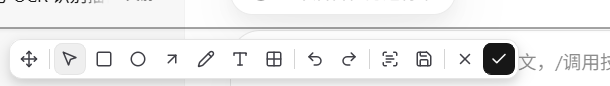
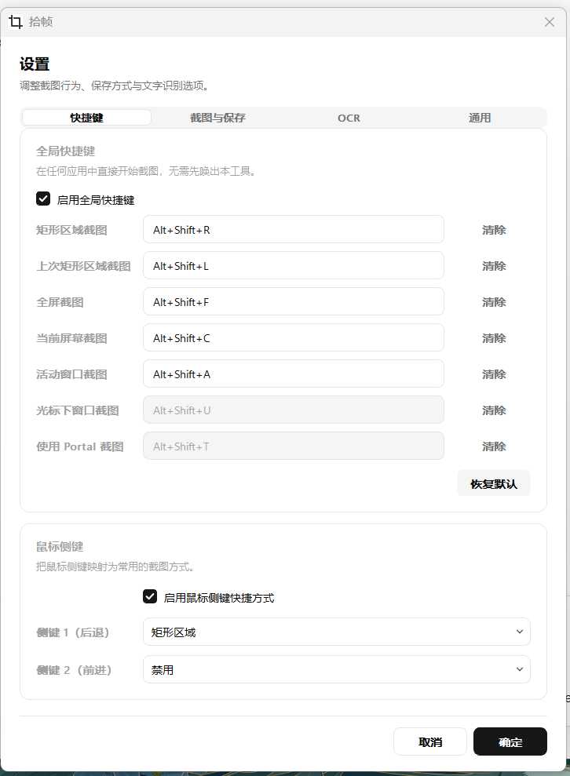
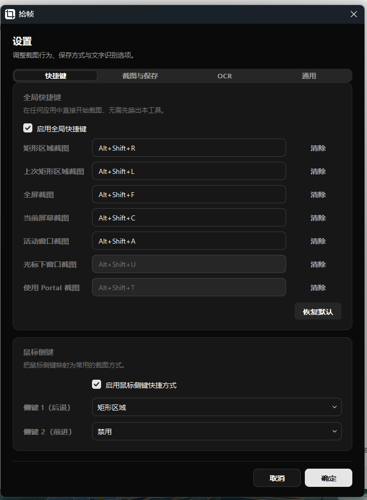
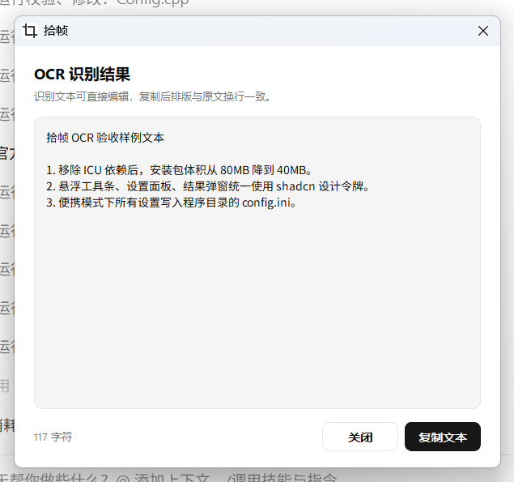

# 拾帧 · Shizhen

**轻量 Windows 截图 / 标注 / OCR 工具。** 一个托盘图标 + 一个悬浮窗，截图、标注、识别文字、复制或保存，全程不打断当前工作。绿色便携，解压即用，**38.4 MB**，不联网、不写注册表。




> 基于 [ksnip](https://github.com/ksnip/ksnip) 1.11.0 + [kImageAnnotator](https://github.com/DamirPorobic/kImageAnnotator) 0.7.2 二次开发，界面按 [shadcn/ui](https://ui.shadcn.com/) 设计语言重做，并按「真正 Lite」的目标重新裁剪了工具链与依赖（80 MB → 38.4 MB，ICU / HarfBuzz / GLib 全部移除）。

---

## 目录

- [功能特性](#功能特性)
- [界面预览](#界面预览)
- [快速开始](#快速开始)
- [快捷键与操作](#快捷键与操作)
- [设置项](#设置项)
- [命令行](#命令行)
- [从源码构建](#从源码构建)
- [技术细节](#技术细节)
- [常见问题](#常见问题)
- [致谢与许可](#致谢与许可)

---

## 功能特性

### 截图

- **6 种取景方式**：矩形区域、上次矩形区域、全屏（所有监视器）、当前屏幕、活动窗口、光标下窗口，每种都有独立全局快捷键。
- **托盘一键截图**：右键托盘图标可直接选「矩形区域 / 活动窗口 / 全屏」，双击托盘图标按默认方式截图。
- **取景框辅助**：放大镜（像素级取点）、坐标与尺寸标尺、八个拖拽手柄、方向键像素级微调、`Ctrl` / `Alt` + 方向键单独调整角点。
- **可调行为**：0–30 秒延迟截图、是否包含鼠标光标、选择区域时是否冻结屏幕（默认冻结）。

### 标注

- **7 种工具**：选择 / 移动已有标注、矩形、椭圆、箭头、画笔、文字、马赛克。
- **撤销 / 重做**，工具选中后浮出二级设置条：颜色、线宽，以及该工具专属项（填充模式、文字颜色与字体字号、马赛克强度）。
- **悬浮窗可拖动**：拖工具条或点「移动」按钮把整个截图窗口挪开，方便对照原窗口。
- **双击工具条 = 完成**，标注结果直接进剪贴板。

### 文字识别（OCR）

- **双引擎**：
  - **Windows 原生 OCR**（默认）：调用系统 WinRT OCR，离线、零依赖，通常 2–3 秒返回，跟随系统语言包。
  - **Ollama 视觉模型**：填本地服务地址与模型名即可改走大模型识别，适合复杂排版或手写体。
- **结果面板**：纯文本编辑框、字数统计、一键「复制文本」，与截图悬浮窗**互不阻塞**——面板开着也能继续标注、保存或直接关掉整组窗口。
- **长文本保护**：显示上限 20 万字符，超出部分点「复制文本」仍可拿到全文。

### 保存与剪贴板

- **保存**：直接落盘到设置目录，文件名 `Shizhen_20261113-150431.png` 这种时间戳格式，同名自动加序号，不弹对话框。
- **格式**：`png` / `jpg` / `bmp` / `webp`。
- **完成（✓）**：复制到剪贴板并关闭浮窗；「新截图自动复制 / 自动保存」可在设置里打开。
- 保存后弹系统通知，点通知可直接打开文件所在目录。

### 常驻与启动

- 纯托盘常驻，无主窗口打扰；单实例运行，重复启动只会提示当前快捷键。
- 开机自启（注册表 Run 项，仅写这一处）、浅色 / 深色 / 跟随系统主题、截图提示气泡（首次显示后自动收起）。
- 鼠标侧键可映射为任意截图方式（后退键 / 前进键各一个）。

### 便携与隐私

- 全部设置写在 **exe 同级的 `config.ini`**，整包拷走配置跟着走；目录只读时自动回退到 `%LOCALAPPDATA%`。
- **零上传**：Imgur / FTP / 脚本上传入口已移除，除本地 Ollama 外没有任何网络请求，包里也没有 OpenSSL。
- 不写注册表（开机自启除外），不产生用户目录缓存。

---

## 界面预览

| 设置 · 浅色 | 设置 · 深色 |
|---|---|
|  |  |

| OCR 识别结果 |
|---|
|  |

---

## 快速开始

1. 到 [Releases](../../releases) 下载最新绿色包，解压到任意目录（**不要**放进 `C:\Program Files`，除非接受配置回退到 `%LOCALAPPDATA%`）。
2. 双击 `Shizhen.exe`。启动后只在托盘出现图标，并弹出一次提示告诉你当前快捷键。
3. 按 `Alt + Shift + R` 拖拽框选，松开后出现悬浮工具条 → 标注 → 点 `✓` 复制或点保存图标落盘。
4. 右键托盘图标 → **设置**，可以改快捷键、保存目录、主题与 OCR 引擎。

> 首次运行可能被 SmartScreen 拦一下（未签名个人构建），点「更多信息 → 仍要运行」即可。

---

## 快捷键与操作

**全局快捷键**（可在 设置 → 快捷键 里改，也可恢复默认）

| 功能 | 默认组合键 |
|---|---|
| 矩形区域截图 | `Alt + Shift + R` |
| 上次矩形区域截图 | `Alt + Shift + L` |
| 全屏截图（所有监视器） | `Alt + Shift + F` |
| 当前屏幕截图 | `Alt + Shift + C` |
| 活动窗口截图 | `Alt + Shift + A` |
| 光标下窗口截图 | `Alt + Shift + U` |

**取景框内**

| 操作 | 说明 |
|---|---|
| 拖拽 | 框选截图区域 |
| 方向键 | 移动选区 1 px；`Ctrl` + 方向键动左上角，`Alt` + 方向键动右下角 |
| `Enter` / 双击 | 确认选区 |
| `Esc` | 取消截图 |
| 60 秒无操作 | 自动取消 |

**悬浮窗内**

| 操作 | 说明 |
|---|---|
| `Esc` | 放弃本次截图（连 OCR 结果面板一起关掉） |
| 双击工具条 | 完成：复制到剪贴板并关闭 |
| `✕` | 放弃 |
| `✓` | 完成（复制到剪贴板） |
| 拖动工具条 / 「移动」按钮 | 挪动整个悬浮窗 |
| 工具按钮 | 选中后下方浮出颜色、线宽等二级设置 |

---

## 设置项

设置窗口分四页，点「确定」写回 `config.ini`（主题与快捷键会立即重载）。

| 页面 | 内容 |
|---|---|
| **快捷键** | 全局快捷键开关与 6 项可用组合键（另列 Portal，Windows 上置灰）、鼠标侧键开关与映射、恢复默认 |
| **截图与保存** | 截图延迟 0–30 s、包含鼠标光标、冻结屏幕、保存目录、保存格式（png/jpg/bmp/webp）、自动复制到剪贴板、自动保存 |
| **OCR** | 引擎切换（Windows 原生 / Ollama）、服务地址（默认 `http://127.0.0.1:11434`）、视觉模型、提示词、测试连接 |
| **通用** | 主题（跟随系统 / 浅色 / 深色）、开机自启、截图时显示左上角操作提示 |

---

## 命令行

适合脚本化：`Shizhen.exe [options] [image]`

| 参数 | 说明 |
|---|---|
| `-r, --rectarea` | 矩形区域截图 |
| `-l, --lastrectarea` | 用上次的矩形区域截图 |
| `-f, --fullscreen` | 全屏截图（含所有监视器） |
| `-m, --current` | 当前鼠标所在屏幕 |
| `-a, --active` | 当前活动窗口 |
| `-d, --delay <秒>` | 延迟截图 |
| `-c, --cursor` | 截图中包含鼠标光标 |
| `-s, --save` | 直接保存到默认目录并退出，不打开编辑窗口 |
| `-p, --saveto <路径>` | 保存到指定路径并退出 |
| `-v, --version` | 版本信息 |

示例：

```bat
:: 3 秒后截全屏并直接存到指定文件
Shizhen.exe -f -d 3 -p D:\shots\full.png
```

---

## 从源码构建

**依赖**：Windows + Qt 5.15.2（官方 `mingw81_64` 套件，不带 ICU）+ MinGW 8.1 + CMake + Ninja。

```bash
# 一次性准备（aqtinstall 可 pip 安装；国内可加清华源）
python -m aqt install-qt windows desktop 5.15.2 win64_mingw81 -O C:/Qt \
       --archives qtbase qtsvg qtwinextras
python -m aqt install-tool windows desktop tools_mingw qt.tools.win64_mingw810 -O C:/Qt

# 构建（MSYS2 / Git Bash）
cd src
bash build-official-qt.sh
```

脚本依次编译 kColorPicker → kImageAnnotator → ksnip，产物安装到 `Shizhen/`，并自动部署最小 Qt 运行库（插件的 `qsvg.dll`、`qsvgicon.dll` 不能漏，否则图标会变空白方块）。8 核机器从零构建约 1 分半。

可用环境变量覆盖默认路径：`QTDIR`、`MINGW`、`PREFIX`、`DIST`。

> 构建、瘦身与验证的完整记录见 [`docs/DEVELOPMENT.md`](docs/DEVELOPMENT.md)。

---

## 技术细节

### 为什么只有 38 MB

| 指标 | 改造前（MSYS2 Qt） | 现在（Qt 官方 + MinGW 8.1） |
|---|---|---|
| 目录体积 | 80 MB | **38.4 MB** |
| 根目录 DLL | 30 个 | **11 个**（8 Qt + 3 MinGW 运行时） |
| 最大单体 | `libicudt78.dll` 33.1 MB | `Qt5Gui.dll` 9.2 MB |
| 字体 / 文本栈 | ICU、HarfBuzz、Graphite2、GLib、FreeType… | 全部静态编入 Qt，走系统 DirectWrite / GDI |

- 官方 Windows Qt 用 `-no-icu` 构建，本地化交给 Win32 NLS，于是 38 MB 的 ICU 一族直接消失；
- HarfBuzz / FreeType / libpng / zlib / pcre2 等都被静态编进 Qt5Core / Qt5Gui，不再散落在根目录；
- 程序本体 `-static-libgcc -static-libstdc++ -s`，exe 3.4 MB；
- 翻译只保留简体 / 繁体中文（88 KB）。

### 运行时开销

| 项目 | 实测 |
|---|---|
| 首个可见窗口 | ≈ 1.3 s（含 800 ms 常驻提示延迟） |
| 私有内存 | ≈ 31 MB |
| 工作集 | ≈ 60 MB（含 Qt DLL 共享页） |
| 线程 | 15 |

### 代码结构

```
src/
├─ ksnip/             主程序（Qt Widgets）
│  └─ src/
│     ├─ gui/style/                    shadcn 令牌层 + Ui 工厂 + 全局 QSS
│     ├─ gui/modelessWindows/          截图悬浮窗、OCR 结果面板
│     ├─ gui/settingsDialog/           shadcn 风格设置对话框
│     ├─ gui/snippingArea/             取景框（放大镜、标尺、手柄）
│     ├─ backend/ocr/                  Windows OCR 与 Ollama 两条通道
│     ├─ backend/config/               config.ini 便携配置
│     └─ common/AppInfo.h              品牌名 / 配置路径唯一来源
├─ kImageAnnotator/   标注引擎（LGPL-3.0）
├─ kColorPicker/      取色器（LGPL-3.0）
└─ build-official-qt.sh
```

---

## 常见问题

**Q：OCR 提示「未识别到文字」或失败？**
Windows 原生 OCR 依赖系统语言包：设置 → 时间和语言 → 语言，确认中文（或目标语言）已安装「光学字符识别」可选功能；也可在 设置 → OCR 里切到 Ollama 试试。

**Q：Ollama 识别很慢 / 连不上？**
先在 设置 → OCR 点「测试连接」。默认地址 `http://127.0.0.1:11434`，模型名要和 `ollama list` 里一致。首次加载视觉模型会慢十几秒，之后快很多。

**Q：工具条图标变成空白方块？**
`imageformats\qsvg.dll` 和 `iconengines\qsvgicon.dll` 缺失。请整目录解压，不要只拷 exe。

**Q：设置改完重启又变回去了？**
程序目录不可写（例如装在 `Program Files` 且没有权限），此时配置会写到 `%LOCALAPPDATA%\Shizhen\Shizhen\config.ini`。想让配置随包走，请放到可写目录。

**Q：为什么没有上传图床 / 云同步？**
这是刻意的取舍：本作只做「截图—标注—识别—复制/保存」闭环，除本地 Ollama 外不发任何网络请求。

**Q：支持哪些 Windows 版本？**
Windows 10 / 11 64 位为验证环境。截图与标注按 Win7 SP1 目标编译，理论上可在 Win7 / 8.1 运行（未逐一实测）；Windows 原生 OCR 依赖 WinRT（Win10 起），深色标题栏依赖 DWM（Win10 1809+）。

---

## 致谢与许可

本项目的界面重做与 Lite 化建立在这些开源工作之上：

- [ksnip](https://github.com/ksnip/ksnip) — 截图与编辑框架，© Damir Porobic
- [kImageAnnotator](https://github.com/DamirPorobic/kImageAnnotator) — 标注引擎
- [kColorPicker](https://github.com/DamirPorobic/kColorPicker) — 取色器
- [shadcn/ui](https://ui.shadcn.com/) — 设计语言与令牌体系
- [Lucide](https://lucide.dev/) — 图标风格参考（本项目自绘 56 枚 SVG）
- [Qt](https://www.qt.io/) 5.15.2 — 应用框架

许可：**GPL-3.0**，见 [`LICENSE`](LICENSE)。因为基于 GPL-3.0 的 ksnip 二次开发，衍生作品需同样以 GPL-3.0 发布并保留源码；kImageAnnotator / kColorPicker 为 LGPL-3.0，本项目以动态库方式链接。
